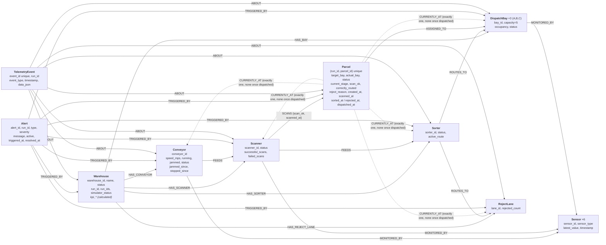

# Warehouse Digital Twin – Neo4j Ontology (meta-schema)

Implemented in `backend/graph/` (constants in `ontology.py`, schema in `init_graph.py`).
Live check in Neo4j Browser: `CALL db.schema.visualization()`.

## Entities

| Entity | Kind | Static properties | Dynamic / calculated properties |
|---|---|---|---|
| Warehouse | asset (root) | warehouse_id, name | status, run_id (active run), run_ids, simulator_status, kpi_* |
| Conveyor | equipment | conveyor_id | speed_mps, running, jammed, status, jammed_since, stopped_since |
| Scanner | equipment | scanner_id | status, successful_scans, failed_scans (per run) |
| Sensor | sensing | sensor_id, sensor_type | latest_value, timestamp |
| Sorter | equipment | sorter_id | status, active_route |
| Parcel | item | parcel_id, run_id, target_bay, created_at | status, current_stage, actual_bay, scan_ok, correctly_routed, reject_reason, scanned_at, at_sorter_at, sorted_at, rejected_at, completed_at, dispatched_at |
| DispatchBay | destination | bay_id, capacity | occupancy, status (available / high / full) |
| RejectLane | destination | lane_id | rejected_count (per run) |
| Alert | event / state | alert_id, run_id, type, severity, triggered_at, message | active, resolved_at |
| TelemetryEvent | history | event_id, run_id, event_type, timestamp, source_id, data_json | – |

Sensors: `SENSOR_CONVEYOR_SPEED`, `SENSOR_PARCEL_PRESENCE` (Conveyor), `SENSOR_BARCODE` (Scanner),
`SENSOR_BAY_A/B/C` (DispatchBay occupancy).

## Parcel state machine

`created (ENTRY) → scanned (SCANNER) → at_sorter (SORTER) → sorted (BAY_x) | rejected (REJECT_LANE) → dispatched (DISPATCHED)`

Parcels only move forward; `sorted` and `rejected` share a rank, so a parcel can never be both.
Each transition replaces the single `CURRENTLY_AT` relationship.

## Relationship notes

- `TRIGGERED_BY` can point at any asset or a parcel (`target_type`: warehouse, conveyor, scanner, sorter, bay, reject_lane, parcel).
- `ABOUT` links an event to every node it concerns: parcel events to the parcel and the stage node, equipment events to that equipment, `simulator_status` to the Warehouse.
- The Sorter has no sensor; the 6 sensors monitor the Conveyor (speed, parcel presence), Scanner (barcode) and each bay (occupancy).

## Constraints and indexes

- Unique: `TelemetryEvent.event_id`, `(Parcel.run_id, Parcel.parcel_id)`, and the id of every equipment node and Alert.
- Indexes: `TelemetryEvent(run_id, timestamp)`, `TelemetryEvent(event_type)`, `Parcel(run_id, status)`, `Alert(run_id, active)`.
